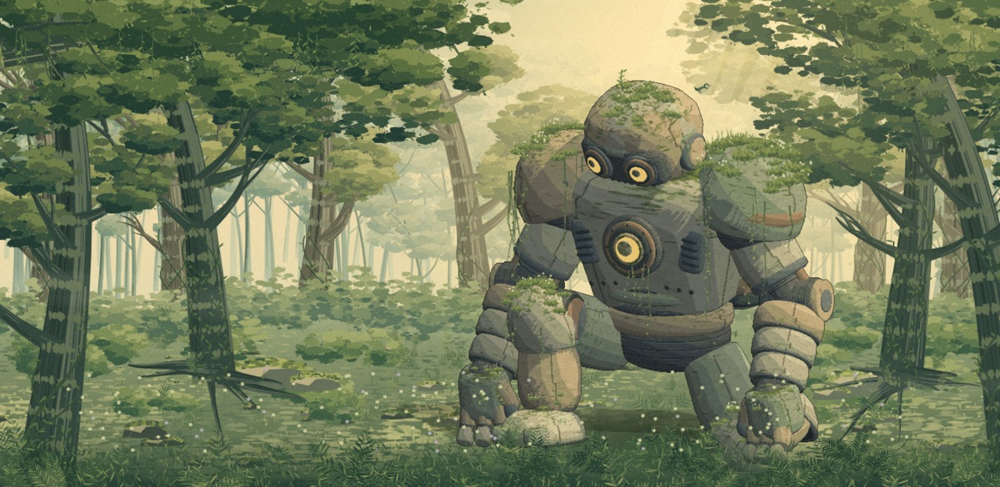

# The Mossbound Giant

**Live demo:** https://Deathdadev.github.io/mossbound-giant/



## Provenance

Built in an **Arena.ai model battle** (Code mode) using **`gpt-6.2-astra-max`**, from a single prompt.

- Arena conversation: https://arena.ai/c/01a1ee04-18ad-7d23-962c-306d0743e37a
  Arena pages sit behind a sign-in and a Cloudflare check, so that link does not render the trace for a logged-out visitor. The full tool-call trace is transcribed here: **[docs/model-trace.md](docs/model-trace.md)**, with the verbatim prompt in **[docs/original-prompt.md](docs/original-prompt.md)**.
- Idea origin: [ChetasLua's "Moss Keeper"](https://x.com/chetaslua/status/2117169796290916732) / [moss-keeper repo](https://github.com/ChetasLua/moss-keeper), a one-file HTML anime short.

Two fixes were applied to the handed-off bundle, neither touching the render pipeline: the four self-hosted font files were absent (the dev server was answering those requests with its HTML 404 body, which Chrome reports as `invalid sfntVersion: 1008821359`), and the MP4 was missing entirely. Both were regenerated with the repo's own tools: (`tools/soundtrack.py` plus `tools/render-film.mjs`) and asset URLs were made page-relative so the single-file bundle resolves under the Pages subpath.

**Not a truly fair comparison.** The Moss Keeper result came from a different harness, and a toolset that very likely included a 3D/Blender-style renderer. This repo was built in Arena's sandboxed code environment (Vite + React + TypeScript + a browser + FFmpeg), with no image generation and no 3D tooling. Treat the outputs as different environments solving the same prompt, not as the same model competing on equal terms.

## Run it

```sh
npm install
npm run dev      # http://localhost:5173
npm run build    # single-file bundle in dist/
```

No API keys, no external media services, no network assets beyond the self-hosted fonts (Instrument Serif, DM Sans. OFL licences in `public/fonts/`).

## The film

`public/film/the-mossbound-giant.mp4` — 42 s, 1,008 frames, 24 fps, 1600 × 780, H.264 + stereo AAC. The player offers scrubbing, three chapter entry points, sound, repeat, cinema view, and native fullscreen. `verification/film-checks.json` records the file's specs and hash.

Re-render it yourself (needs Python + NumPy, FFmpeg, Playwright with Chromium, and the dev server running):

```sh
python tools/soundtrack.py canopy-soundtrack.wav
SOUNDTRACK=canopy-soundtrack.wav node tools/render-film.mjs
```

The renderer pushes all 1,008 frames to FFmpeg in sequence rather than screen-recording, so the MP4 is byte-reproducible for a given commit.

## Why it is not a slideshow

| Requirement | How it is met |
| --- | --- |
| In-between frames every second | `src/film/guardian.ts` recomputes the articulated character 12 times per second; motion is interpolated, not stepped. |
| Continuous secondary motion | Mist, foliage, birds, dust, debris and camera parallax are computed from absolute time in `src/film/scene.ts`, so seeking to any second re-derives the same frame. |
| Temporally stable geometry | `src/film/ink.ts` is an orthographic rasterizer with fixed meshes, UV-stable pigment, discrete cel-light bands, and depth-derived ink contours. No WebGL, no specular shading. |
| Real video delivery | The MP4 above, plus unbroken canvas playback in the browser. |
| No AI-generated imagery | All artwork is procedural code; the only downloaded assets are the two OFL-licensed fonts. |

`tools/check-player.mjs` runs 17 browser checks (decoding, duration, scrubbing, chapter seeking, keyboard shortcuts, fullscreen, responsive widths, reduced motion) against the live page.

## Layout

```
src/film/drawing.ts    geometry, easing, brush primitives
src/film/forest.ts     layered woodland, mist, ferns, stones
src/film/ink.ts        software rasterizer: cel bands, shadows, contours
src/film/guardian.ts   articulated guardian, 12 drawings per second
src/film/scene.ts      per-frame composition at 24 fps
src/film/reel.ts       chapters, duration, film URL
tools/soundtrack.py    synthesised score from oscillators and filtered noise
tools/render-film.mjs  headless frame pump → FFmpeg
tools/check-player.mjs  Playwright player assertions
docs/                  arena trace + original prompt
verification/          screenshots + film/player check results
```

## Keyboard

| Key | Action |
| --- | --- |
| Space | play / pause |
| M | sound on / off |
| F | fullscreen |
| ← / → | seek 5 s |
| Esc | close journal, leave cinema mode |


